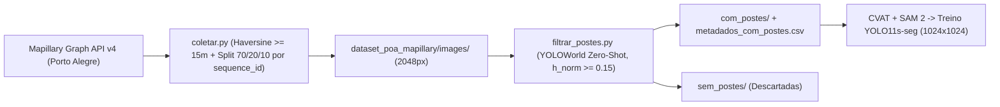

# Coleta e Triagem de Imagens Urbanas (Mapillary) — Fiscalização de Postes em Porto Alegre (RS)

Repositório do pipeline de aquisição, deduplicação geodésica e pré-triagem de imagens de nível de rua em **Porto Alegre (RS)** utilizando a **Mapillary Graph API v4** e **YOLO-World**.

Este projeto faz parte de uma **Residência em Inteligência Artificial** voltada à fiscalização automatizada do acúmulo irregular de fiação elétrica e de telecomunicações ("fios mortos" e cabos rompidos) em postes urbanos, alinhado aos **ODS 9, 11 e 12 da ONU**. Os dados coletados e triados por este repositório alimentam a rotulagem no **CVAT + SAM 2** e o treinamento do modelo de segmentação de instâncias **`YOLO11s-seg` (`1024x1024`)**.

---

## Arquitetura do Pipeline



### 1. `coletar.py` — Coleta Geográfica, Deduplicação e Split sem Vazamento
- **Grade Geográfica (`POA_BBOX`):** Cobre a região central de Porto Alegre (`[-51.2350, -30.0450, -51.2050, -30.0250]` — Centro Histórico, Cidade Baixa, Bom Fim e Floresta) subdividida em células de `0.008°` (abaixo do limite de `0.01°` da API v4).
- **Filtros de Qualidade:** Descarta imagens panorâmicas 360° (`is_pano=false`) para evitar distorções geométricas equiretangulares, filtra capturas a partir de `2023-01-01T00:00:00Z` e baixa imagens em alta resolução (`thumb_2048_url` / 2048px) para preservar a nitidez de cabos finos antes do redimensionamento para `1024x1024`.
- **Deduplicação Espacial (Haversine):** Ordena as capturas por `(sequence_id, captured_at)` e descarta frames a menos de **`15.0` metros** do último frame aceito dentro da mesma sequência **antes do download**, evitando fotos repetidas em semáforos ou trânsito lento.
- **Prevenção de *Data Leakage*:** Realiza a divisão determinística (`seed=42`) em `train` (70%), `val` (20%) e `test` (10%) **agrupando estritamente por `sequence_id`**, garantindo que ângulos diferentes do mesmo poste jamais apareçam simultaneamente no treino e na validação/teste.
- **Saída:** `dataset_poa_mapillary/images/<image_id>.jpg` e `dataset_poa_mapillary/metadados_poa.csv`.

### 2. `filtrar_postes.py` — Pré-triagem Local Zero-Shot (`YOLOWorld`)
- **Aceleração Multiplataforma:** Detecta automaticamente o hardware disponível via `detectar_dispositivo()` (`mps` no Apple Silicon, `cuda` em GPUs NVIDIA ou `cpu` no Linux Fedora AMD / Windows CPU).
- **Inferência Zero-Shot:** Utiliza `YOLOWorld("yolov8s-worldv2.pt")` com as classes `["utility pole", "electricity pole", "light pole"]` (`conf=0.18`, `imgsz=640`).
- **Filtro de Enquadramento Vertical:** Aprova a imagem somente se houver ao menos um poste cuja caixa delimitadora possua altura normalizada **`h_norm >= 0.15`**, eliminando imagens em que postes aparecem apenas minúsculos no horizonte.
- **Saída Sincronizada:** Copia as imagens aprovadas para `dataset_poa_mapillary/com_postes/`, as descartadas para `dataset_poa_mapillary/sem_postes/` e exporta `dataset_poa_mapillary/metadados_com_postes.csv` preservando a coluna `split`.

---

## Instalação do `uv` (Sem Privilégios de Administrador)

Este projeto utiliza o gerenciador **[uv](https://docs.astral.sh/uv/)** para garantir reprodutibilidade multiplataforma e velocidade na resolução de dependências (incluindo PyTorch CPU-only automático no Linux e suporte nativo a MPS/CUDA no macOS/Windows).

### Linux (Fedora / Zsh)
```bash
curl -LsSf https://astral.sh/uv/install.sh | sh && source ~/.zshrc
```

### macOS (Apple Silicon / Zsh sem admin)
```bash
curl -LsSf https://astral.sh/uv/install.sh | sh && source ~/.zshrc
```

### Windows (PowerShell)
```powershell
powershell -ExecutionPolicy ByPass -c "irm https://astral.sh/uv/install.ps1 | iex"
```

---

## Fluxo Completo de Uso

### 1. Sincronizar o ambiente e configurar o token da API Mapillary
```bash
# Sincroniza o ambiente virtual (.venv) a partir do uv.lock
uv sync

# Copia o template de variáveis de ambiente (caso .env ainda não esteja preenchido)
cp .env.example .env
```
Edite o arquivo `.env` e insira seu token de acesso da Mapillary Graph API v4:
```ini
MAPILLARY_ACCESS_TOKEN=MLY|seu_token_real_aqui
```

### 2. Executar a coleta e deduplicação geográfica em Porto Alegre
```bash
uv run coletar.py
```

### 3. Executar a pré-triagem local com YOLO-World
```bash
uv run filtrar_postes.py
```

### 4. Validar qualidade de código e formatação com Ruff
```bash
uv run ruff check .
uv run ruff format --check .
```

---

## Estrutura do Repositório

```text
.
├── .agent/
│   └── rules/
│       └── agents.md        # Regra de projeto para Antigravity CLI (agy) / Gemini CLI
├── .env.example             # Template de configuração do token Mapillary
├── .gitignore               # Ignora .venv/, .env, *.pt e dataset_poa_mapillary/
├── .python-version          # Versão do Python gerenciada pelo uv (3.12)
├── AGENTS.md                # Fonte Única da Verdade (arquitetura e regras para agentes)
├── CLAUDE.md                # Ponteiro de contexto para o Claude Code (@AGENTS.md)
├── GEMINI.md                # Ponteiro de contexto para Gemini CLI e agy (@AGENTS.md)
├── README.md                # Documentação principal e guia de uso
├── coletar.py               # Coleta Mapillary API v4 + Haversine 15m + Split 70/20/10
├── filtrar_postes.py        # Pré-triagem Zero-Shot com YOLOWorld (h_norm >= 0.15)
├── pyproject.toml           # Dependências, índice pytorch-cpu no Linux e config do Ruff
└── uv.lock                  # Lockfile determinístico multiplataforma
```
